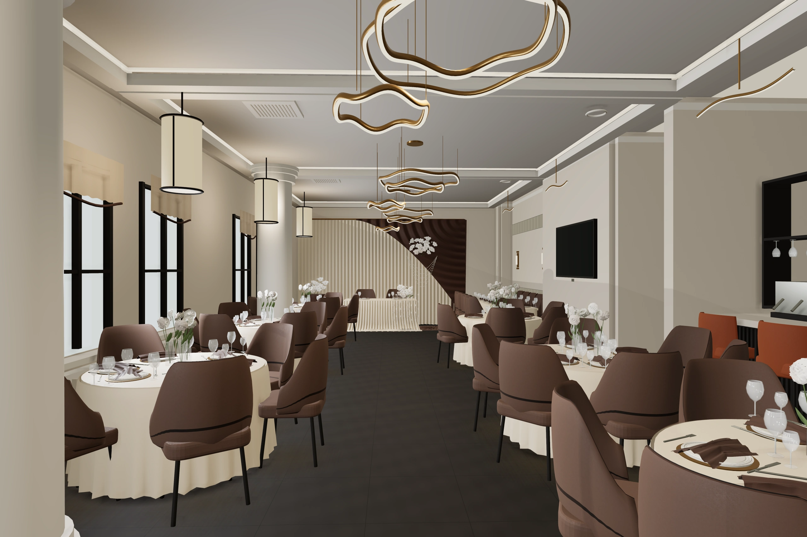

# Ариадна · прогулка по банкетному залу

Готовый статический сайт для GitHub Pages. Серверная часть и сборка не нужны. Все зависимости, шрифт и фотографии лежат рядом с сайтом. Внешние CDN при просмотре не используются.

## GitHub Pages

**Сайт: https://846digital.github.io/Ariadna3D/**

Файлы находятся в корне репозитория. GitHub Pages публикуется из ветки **main**, папки **/ (root)**. Установка зависимостей и сборка не нужны.

Свет выбирается рядом с оформлением в правом верхнем углу. Доступны дневной свет, только окна, только люстры и тёплый вечер. Кнопка **Сцена** переводит к исправленному музыкальному подиуму.



## Управление

- **ПК:** W A S D для перемещения, мышь для обзора после нажатия на зал. Также можно тянуть изображение мышью. Стрелки вверх и вниз двигают, влево и вправо поворачивают. Shift ускоряет шаг, Esc освобождает курсор.
- **Телефон:** джойстик слева для перемещения, движение пальцем по залу для обзора. Обеими руками можно управлять одновременно.
- **Расстановка:** «План зала» → «Изменить расстановку». Перетаскивайте столы со стульями, добавляйте и удаляйте столы. Новый круглый стол получает 6 стульев; количество меняется от 1 до 12. В раскрывающемся разделе можно поменять два стола местами или сдвинуть выбранный на 10 см. «Вернуть исходную» восстанавливает схему на 47 мест. Расстановка сохраняется в браузере этого устройства.
- **План:** нажмите «План зала», затем на свободный участок пола, чтобы переместиться туда. Колесо мыши или жест двумя пальцами меняют масштаб плана.
- **Точки обзора:** внизу есть переходы к президиуму, столам, окнам и бару.
- **Фотографии:** кнопка с изображением открывает ваши материалы, схему и фотографии ресторана.
- **Настройки:** дневной свет, свет только из окон, только от люстр и вечерний свет, качество, скорость, чувствительность, видимость миникарты и декора. Настройки сохраняются только в браузере пользователя.

## Независимые настройки декора

В блоке «Оформление зала» доступны:

- **Оформление:** четыре палитры тканей. Они действуют и на добавленные столы.
- **Президиум:** исходный или новый по присланным фотографиям. Во втором варианте две шоколадные портьеры, открытый молочный центр, сваги на скатерти, напольные композиции, свечи и зеркальные шары.
- **На столах:** цветы в вазочках или молочные свечи в прозрачных цилиндрах разной высоты.
- **Палитра цветов:** как сейчас или разноцветные дофаминовые. Меняется цвет лепестков, расположение композиций сохраняется. Выбор действует на президиум и на гостевые цветы, когда они включены.
- **Свет:** четыре прежних режима.

Настройки работают независимо и сохраняются в браузере. На телефоне блок оформления раскрывается нажатием на его название. Фотографии новых вариантов добавлены в галерею.

## Четыре оформления

1. **По фотографии:** молочные скатерти и фон, шоколадная драпировка, белая флористика, жемчужные подвесы и кружево.
2. **Пыльная роза:** розовые скатерти и фон президиума, оливковые салфетки и драпировка, белые и розовые цветы с оливковыми акцентами.
3. **Олива и шоколад:** оливковые скатерти и фон, шоколадные салфетки и драпировка, сдержанные светлые композиции с зеленью.
4. **Бежевый и фисташковый:** бежевые скатерти, фисташковые салфетки и драпировка, молочно-бежевый фон и розовые цветочные оттенки по новому референсу.

**Переключение оформления меняет только цвета материалов.** Расстановка, геометрия складок, состав и количество цветов, кружево, бусины, сервировка и светильники остаются одними и теми же. Коричневые кресла сохраняют свой цвет. Это проверяется сравнением геометрии, видимости объектов и всех матриц экземпляров между четырьмя вариантами.

В галерею включены кадры одной модели в разных палитрах и отдельные кадры нового президиума. Новый вариант драпировки включается только выбором президиума. Сведения о рендеринге находятся в `RENDERS.md`.

## Детали и рендер

У кресел замкнутая мягкая оболочка с низкими подлокотниками, подушка, окантовка и фактура бархата. Цветы состоят из объёмных лепестков, ветвей, листьев и бутонов. На президиуме сохранены три композиции, нити бусин, кружевной спуск, сборка скатерти и ткань на полу. Бар имеет открытую раму с подвесными бокалами. В правой части зала находится открытая низкая музыкальная сцена с закруглённым подиумом, растительной росписью и акустикой. Телевизор находится на длинной стене слева от бара; бар — в центральном проёме.

Материалы тканей используют локальные карты 2K; для пола и стен добавлены карты камня и штукатурки, у кресел уточнена фактура ворса. Форма крупных складок круглых скатертей стала мягче. Исходные цвета молочной ткани сохранены.

Освещение архитектуры рассчитано заранее: шесть отражений света, отдельные основы для окон и светильников, пространственные пробы для мебели и карты пола и потолка. Ткани и мебель получают освещение в мировых координатах, включая новые и переставленные столы. Мебель не запечена в пол: её контактные тени рассчитываются при просмотре. Блики используют карты отражений самого зала; узкие зеркальные полосы сохраняют настоящее плоское отражение.

**Качество:** «Автоматически» сохраняет контактные тени во время ходьбы и регулирует внутреннее разрешение по скорости кадров. После остановки возвращается полная чёткость выбранного режима. «Максимум · до 4K» допускает 3840 × 2160 на подходящем экране ПК, увеличивает разрешение зеркал и теней и включает преломление стекла. Во время движения разрешение также может снижаться при недостатке производительности. На телефоне размер кадров ограничен отдельно. «Экономно» отключает дополнительные эффекты. Подробности и условия замеров — в `PERFORMANCE.md`.

Кнопка камеры открывает **рендер выбранного ракурса**. Доступны 1920, 2560 и 3840 пикселей по длинной стороне, обычное и повышенное сглаживание. Экспорт всегда включает максимальные материалы, тени и преломление стекла, затем возвращает настройки прогулки. Кадр собирается небольшими участками с перекрытием: GPU не требует гигантского буфера. Предусмотрены прогресс, отмена и сохранение PNG. Готовые превью в галерее обновлены из текущей модели, 2560 × 1707, WebP 96. Новые карты освещения и текстуры включены в сайт; сервер расчётов не нужен.

Это PBR-рендеринг с заранее рассчитанным приближённым диффузным освещением, GTAO, теневыми картами и отражениями. Полная трассировка лучей во время ходьбы не применяется. Модель остаётся художественной реконструкцией по фотографиям.

## Точность

Модель — художественная реконструкция по фотографиям и схеме рассадки на **47 человек**. Контур и относительные положения мебели основаны на схеме. Размеры, высота, точные оконные интервалы и невидимые участки оценены по изображениям. Это не обмерная модель и не фотограмметрический скан. Подробный разбор источников находится в `RESEARCH.md`.

Основная модель создаётся кодом в `scene.js`; подробная геометрия — в `detail-geometry.js`, исходный план — в `layout.js`, редактируемая расстановка — в `table-layout.js` и `table-editor.js`, новая драпировка — в `presidium-geometry.js`, графические эффекты и экспорт кадров — в `render-still.js`. Все ресурсы уже включены в папку.

## Локальный запуск

Открывайте проект через HTTP, поскольку JavaScript-модули не загружаются двойным нажатием на HTML-файл через `file://`.

Если установлен Python, выполните в этой папке:

```text
python -m http.server 4173
```

Затем откройте `http://localhost:4173/`. Для просмотра на iPhone можно сразу использовать GitHub Pages.

## Совместимость и лицензии

Проверено 16 ноября 2026 года: загрузка по подпути, клавиатурная ходьба, препятствия у столов и колонн, сенсорный джойстик вместе с поворотом вторым пальцем, три оформления, неизменный цвет кресел, переход с плана, настройки и девять изображений в галерее. Проверены ширины 320, 375, 414 и 768 пикселей. При проверке не было ошибок JavaScript, отсутствующих ресурсов и запросов к внешним CDN.

Нужен современный браузер с WebGL 2. На менее мощном устройстве выберите качество «Экономно». Производительность зависит от устройства; физическая проверка на iPhone не заменяется эмуляцией браузера.

Three.js r180 распространяется по MIT, лицензия в `vendor/THREE-LICENSE.txt`. Текстуры Poly Haven распространяются по CC0; источники перечислены в `assets/MATERIALS.md`. Manrope распространяется по SIL Open Font License, лицензия в `assets/FONT-LICENSE.txt`. Фотографии относятся к указанным в исследовании источникам и используются как референсы этой визуализации. Проект не является официальным сайтом ресторана.

Свет выбирается в правом верхнем углу рядом с оформлением: **Дневной**, **Только окна**, **Только люстры**, **Тёплый вечер**. Солнце направлено через оконные проёмы; четыре тёплых источника находятся у групп кольцевых люстр. Переключение света не меняет цвета материалов и расстановку.
